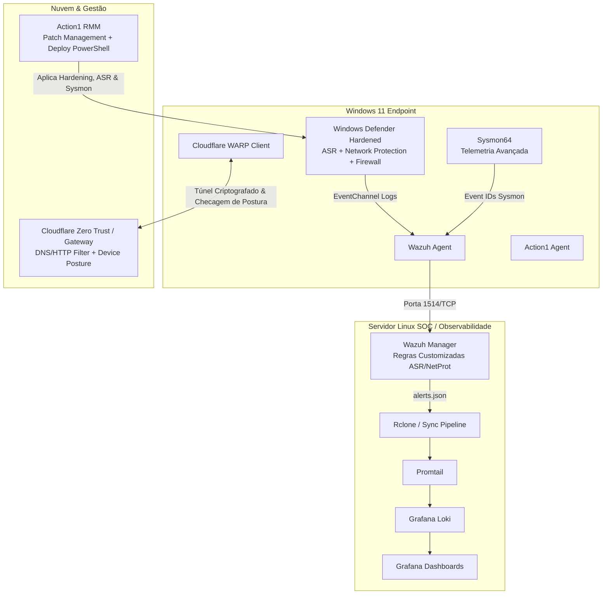

"# Defender-Hardening-Observability" 

# 🛡️ ZeroCost-SecOps-Stack: Arquitetura de Defesa Corporativa para Endpoints Windows 11

Uma arquitetura completa de **Defesa em Profundidade (Defense-in-Depth)**, **Zero Trust**, **Hardening de Endpoint** e **Observabilidade SIEM/SOC** construída 100% com ferramentas gratuitas e open-source.

Este projeto demonstra como elevar o nível de segurança do Windows 11 nativo ao patamar de soluções EDR/XDR comerciais pagas, integrando proteção de rede na borda, gestão automatizada de patches, bloqueio comportamental no kernel e centralização de alertas em tempo real.

---

## 🏗️ Arquitetura da Solução



---

## 🧩 Camadas de Segurança e Ferramentas

| Camada | Ferramenta | Função na Arquitetura |
| :--- | :--- | :--- |
| **Perímetro & Zero Trust** | **Cloudflare WARP + Gateway** | Filtragem DNS/HTTPS na nuvem, bloqueio de phishing/C2 e validação de postura (*Device Posture Check* exigindo Firewall ativo). |
| **Gestão & Automação (RMM)** | **Action1** | Gerenciamento automatizado de patches (SO e terceiros) e execução em massa de scripts PowerShell como `SYSTEM`. |
| **Prevenção no Endpoint (EPP)** | **Windows Defender (Endurecido)** | Ativação via PowerShell de recursos ocultos corporativos: **Regras ASR** (*Attack Surface Reduction*) e **Network Protection** (IPS de saída). |
| **Telemetria Profunda** | **Sysmon64 (Sysinternals)** | Monitoramento granular de criação de processos, conexões de rede e alterações críticas no registro/sistema. |
| **SIEM & Detecção** | **Wazuh** | Coleta centralizada via `eventchannel` e regras customizadas para alertar bloqueios de rede (`1126`/`1127`) e ASR (`1121`). |
| **Observabilidade & Painéis** | **Promtail + Loki + Grafana** | Ingestão dos alertas JSON do Wazuh e visualização executiva em tempo real de bloqueios, URLs maliciosas e hosts afetados. |

---

## 📂 Estrutura do Repositório

```text
ZeroCost-SecOps-Stack/
├── powershell-hardening/
│   ├── enable-defender-asr.ps1       # Ativa MAPSReporting, Network Protection e 10 regras ASR
│   ├── hardening-firewall.ps1        # Endurecimento do Firewall local do Windows 11
│   └── update-sysmon64.ps1           # Atualização segura do binário Sysmon64 via Action1
├── wazuh-config/
│   ├── agent.conf                    # Configuração centralizada (coleta canal Windows Defender)
│   └── local_rules.xml               # Regras customizadas 100501 (Network Protection) e 100502 (ASR)
├── grafana-loki/
│   ├── promtail-config.yaml          # Pipeline de ingestão dos alertas JSON do Wazuh
│   └── dashboard-defender.json       # Painel pronto para importar no Grafana
└── README.md
```

---

## 🚀 Guia Rápido de Implantação

### 1. Hardening do Windows 11 (Via Action1 / PowerShell)
Execute o script `enable-defender-asr.ps1` nos endpoints para destravar as funções avançadas do Microsoft Defender:
* Ativa `MAPSReporting` (`Advanced`) e envio de amostras.
* Habilita `EnableNetworkProtection` (`Enabled`) para bloquear conexões maliciosas de qualquer processo (fora do Edge).
* Aplica as principais regras **ASR** (bloqueio de roubo de credenciais LSASS, bloqueio de macros/processos filhos no Office, bloqueio de scripts ofuscados e proteção contra ransomware).

### 2. Configuração do Wazuh (Servidor Linux)
1. Adicione o canal operacional do Defender no `/var/ossec/etc/shared/default/agent.conf`:
   ```xml
   <agent_config os="Windows">
     <localfile>
       <location>Microsoft-Windows-Windows Defender/Operational</location>
       <log_format>eventchannel</log_format>
     </localfile>
   </agent_config>
   ```
2. Adicione as regras customizadas no `/var/ossec/etc/rules/local_rules.xml` para promover bloqueios de rede e ASR a alertas de nível 10:
   ```xml
   <group name="windows,windows_defender,">
     <rule id="100501" level="10">
       <if_group>windows</if_group>
       <field name="win.system.eventID">^1126\(\vert{}^1127\)</field>
       <description>Windows Defender Network Protection: Conexao maliciosa bloqueada (\$(win.eventdata.destination)).</description>
     </rule>
     <rule id="100502" level="10">
       <if_group>windows</if_group>
       <field name="win.system.eventID">^1121\$</field>
       <description>Windows Defender ASR: Comportamento suspeito bloqueado.</description>
     </rule>
   </group>
   ```
3. Valide e reinicie o serviço:
   ```bash
   /var/ossec/bin/wazuh-analysisd -t && systemctl restart wazuh-manager
   ```

### 3. Visualização no Grafana (Loki + Promtail)
Importe o JSON do dashboard no Grafana e utilize a query LogQL abaixo para monitorar detecções de malware, ASR e bloqueios de URL/IP em tempo real:
```logql
{job=~"wazuh-alerts|wazuh-archives"} | json | data_win_system_eventID=~"1115|1116|1117|1121|1125|1126|1127|1129"
```

---

## 🧪 Validação e Testes

Para validar se a cadeia completa (Endpoint → Wazuh → Grafana) está operacional:
* **Teste de Network Protection (Event ID 1126):** Acesse `https://smartscreentestratings2.net` via PowerShell (`Invoke-WebRequest`), Chrome ou Firefox.
* **Teste de Antimalware (Event ID 1116):** Utilize o arquivo padrão de teste `EICAR`.

---

## 📄 Licença
Este projeto está sob a licença MIT. Sinta-se à vontade para usar, adaptar e contribuir!

